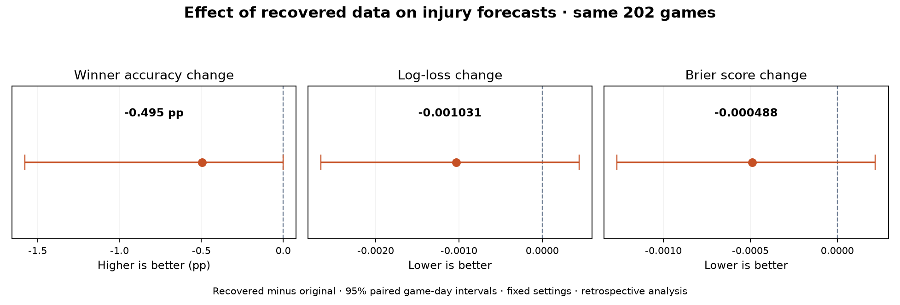

# Separate recovered-data backtest

Original study outputs and production forecasts are unchanged. This experiment uses separate input snapshots and output files.

## Finding

On the same 202 originally covered games, injury-adjusted winner accuracy changed from 72.28% to 71.78% (-0.50 percentage points). Log-loss changed from 0.555921 to 0.554891, and Brier score from 0.186184 to 0.185696. Lower probability scores are better.

The paired recovery-effect 95% intervals are -1.58 to +0.00 pp for accuracy, -0.002659 to +0.000445 for log-loss, and -0.001268 to +0.000219 for Brier score. Both probability-score intervals include zero; this study does not establish a clear improvement.

The original study, live forecast, and prospective model-selection evidence remain unchanged.

Reproduced the original 324 game probabilities within 1e-8 before comparing recovered inputs. Score-only predictions are unchanged within 1e-10. Player effects use the original fixed 2025–2026 protocol, monthly past-only fitting, and the same caps and hyperparameters. This avoids confounding recovery with subsequent production model changes.

## Same original covered games — primary comparison

Exactly the original 202 covered games in both runs; no sample-composition change.

| Metric | Score-only | Original injury model | Recovered-data injury model | New injury minus score-only (95% interval) |
|---|---:|---:|---:|---:|
| accuracy | 72.28% | 72.28% | 71.78% | -0.50 pp [-2.22, +1.03] |
| log loss | 0.556734 | 0.555921 | 0.554891 | -0.001844 [-0.005269, +0.001884] |
| brier | 0.186297 | 0.186184 | 0.185696 | -0.000601 [-0.002154, +0.001074] |

## All original games — same fallback policy

The same 324 games, including score-only fallbacks when a report was unavailable. Recovered reports can change a fallback into an adjustment.

| Metric | Score-only | Original injury model | Recovered-data injury model | New injury minus score-only (95% interval) |
|---|---:|---:|---:|---:|
| accuracy | 69.14% | 69.14% | 68.83% | -0.31 pp [-1.44, +0.64] |
| log loss | 0.582351 | 0.581844 | 0.581137 | -0.001214 [-0.003424, +0.001068] |
| brier | 0.197966 | 0.197896 | 0.197564 | -0.000403 [-0.001407, +0.000628] |

## Coverage change

Player box scores: 636 → 637. Verified report files: 146 → 151. Both-team report-covered games: 202 → 207; 5 newly covered games.

The expanded cohort is a different sample. Its aggregate accuracy must not be compared directly with the original covered-sample accuracy as evidence of model improvement.

On the expanded 207-game cohort, score-only accuracy is 71.50% and injury-adjusted accuracy is 71.01%. Score-only versus injury-adjusted log-loss is 0.561390 versus 0.559489; Brier score is 0.188533 versus 0.187902. The five newly covered games alone have 40% winner accuracy for both models and are too few for a reliable separate conclusion.

| New covered game | Date (Eastern) | Matchup |
|---|---|---|
| 401856947 | 2026-05-29 | Minnesota Lynx at Chicago Sky |
| 401857037 | 2026-07-03 | Minnesota Lynx at New York Liberty |
| 401857038 | 2026-07-03 | Chicago Sky at Las Vegas Aces |
| 401857040 | 2026-07-04 | Portland Fire at Seattle Storm |
| 401857042 | 2026-07-05 | Indiana Fever at Las Vegas Aces |

## What changed in the injury predictions?

Across all 324 games, 125 injury-adjusted probability pairs changed and the winner pick changed in 1 game. `original_vs_recovered_games.csv` contains the original and recovered predictions for each game.

The separate paired recovery-effect comparison in `original_vs_recovered.json` compares the new injury forecast directly against the original injury forecast on the same games. Its intervals use 10,000 paired resamples of game days.

## Limits

- Settings and report-time rules fixed to the original historical protocol; no tuning to these outcomes.
- Recovery changed available inputs; same-game cohorts isolate it from changes in sample composition.
- This is retrospective, not new independent prospective evidence, and cannot trigger model promotion.
- Game-day bootstrap intervals are approximate and conditional on the fitted models.
- Minute restrictions, projected lineups, mid-game scenarios, and championship forecasts are not validated by this study.

## Audit and reproduce

Pinned fitting function source: Git commit `dbab1765e8ec4dcc426a25830dc332791f49524e`. The copied fitting protocol, input snapshots, their SHA-256 hashes, and reproduction errors are retained here.

Run `.venv/Scripts/python.exe -X utf8 scripts/backtest_recovered_data.py --inputs-source outputs/recovered_data_backtest/inputs --output outputs/recovered_data_backtest_NEW` to create another separate experiment. Existing experiment folders and the live study cannot be overwritten by this runner.

All protected original-file SHA-256 hashes matched after both runs. No live data refresh, notification, model promotion, or website publication was performed.
